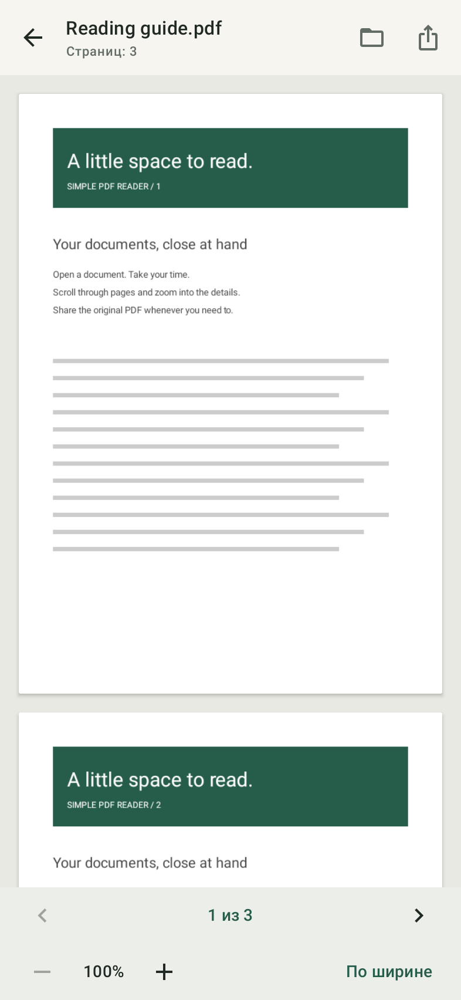

# Simple PDF Reader

Локальное Android-приложение для чтения и отправки PDF. Рабочая версия — **0.1.0**.

 

Скриншоты UI-тестов; на экране чтения показана тестовая иллюстрация страницы.

## Возможности

- Выбор PDF через системный файловый диалог (включая установленные облачные провайдеры).
- Открытие из другого приложения через «Открыть с помощью» и приём одного PDF через Share.
- Вертикальная прокрутка, кнопки перехода между страницами и переход по номеру.
- Масштаб 100–300% кнопками и жестом двумя пальцами; перемещение увеличенной страницы.
- Share передаёт PDF-файл, а не ссылку: Android сам предлагает мессенджеры, почту и другие приложения.
- Сохранение документа и позиции при повороте экрана и восстановлении системой текущей задачи.
- Русский интерфейс, светлая и тёмная тема по настройке Android. Страницы PDF сохраняют оригинальные цвета.
- Нет рекламы, аналитики, аккаунтов и разрешения на доступ к интернету.

## Запуск

Требуются JDK 17 и Android SDK. Минимальная версия устройства — **Android 8.0 (API 26)**.

1. Откройте корневую папку в Android Studio с поддержкой AGP 9.4.
2. Установите Android SDK Platform 37 и Build Tools 36.0.0 через SDK Manager.
3. Дождитесь синхронизации Gradle, выберите устройство и нажмите Run для модуля `app`.

Командная строка:

```sh
# На macOS, если установлены несколько JDK:
export JAVA_HOME=$(/usr/libexec/java_home -v 17)

# Укажите свой SDK (или создайте local.properties с sdk.dir=/путь/к/sdk).
export ANDROID_HOME=/путь/к/android-sdk
./gradlew :app:assembleDebug
./gradlew :app:testDebugUnitTest :app:lintDebug
```

Результат сборки: `app/build/outputs/apk/debug/app-debug.apk`.

Установка на подключённый телефон с включённой USB-отладкой:

```sh
adb install -r app/build/outputs/apk/debug/app-debug.apk
```

Первый запуск сборки на другом компьютере потребует доступа к Google Maven, Maven Central и Gradle. В репозитории есть Gradle Wrapper; отдельная установка Gradle не нужна. `local.properties` содержит только локальный путь к SDK и исключён из Git.

## Устройство проекта

| Файл | Назначение |
| --- | --- |
| `MainActivity.kt` | Системный выбор файла, входящие intent и Android Sharesheet |
| `ReaderViewModel.kt` | Состояния экрана, загрузка вне UI-потока и восстановление позиции |
| `DocumentStore.kt` | Собственные копии файлов, ограничения размера, безопасные имена |
| `PdfSession.kt` | Системный PdfRenderer, последовательный доступ к страницам и ограниченный кэш |
| `ReaderScreen.kt` | Интерфейс Jetpack Compose, прокрутка, масштаб, переход к странице |
| `PdfIntents.kt` | Приём PDF и передача файла через FileProvider с правом чтения |

Файлы находятся в `app/src/main/java/com/taktey/simplepdfreader`.

Стек: Kotlin (встроенная поддержка AGP), Jetpack Compose / Material 3, Android PdfRenderer, Gradle 9.6.0, AGP 9.4.0. Версии зависимостей зафиксированы. Для первой версии используется системный PDF-движок; сторонний нативный PDF-движок не поставляется.

## Хранение и ограничения первой версии

- При открытии приложение копирует документ в своё приватное хранилище. Это позволяет читать PDF из потоковых провайдеров и повторно отправлять файл после истечения исходного разрешения.
- Share выдаёт получателю временный доступ только на чтение. Исходный файл приложение не изменяет.
- Старые копии старше семи дней удаляются при следующем успешном открытии документа. Текущий документ сохраняется. Удаление данных приложения удаляет все копии; автоматическое облачное резервирование отключено.
- Лимит одного файла — 200 МиБ. Для открытия нужно свободное место под его копию.
- PDF с паролем, редактирование, выделение текста, поиск, OCR, закладки и список недавних файлов в эту версию не входят.
- Позиция восстанавливается внутри текущей задачи Android, в том числе после пересоздания процесса системой. История чтения между независимыми запусками пока не ведётся.
- Растровый кэш ограничен 24 МиБ; одна страница — примерно 16 МиБ. При очень большом увеличении сложных страниц детализация ограничивается этим бюджетом.
- Это debug-сборка для локальной установки. Публикация в Google Play и настройка release-подписи не выполнялись.

## Проверка

Локальные автотесты покрывают копирование без изменения содержимого, ограничения размера, безопасные имена, URI и права Share, импорт PDF, навигацию и основные действия интерфейса. Robolectric использует Android API 34 и native graphics; первый запуск может скачать Android runtime. Скриншоты тестов сохраняются в `app/build/screenshots`. Экран чтения в UI-тестах использует тестовое изображение страницы: системный PDF-движок в Robolectric не реализован.

Рендеринг настоящего PDF, его геометрию и обработку повреждённого файла проверяет `PdfRendererDeviceTest` в `app/src/androidTest`. Для запуска нужен телефон или эмулятор:

```sh
./gradlew :app:connectedDebugAndroidTest
```

Ручные сценарии для телефона перечислены в [docs/TESTING.md](docs/TESTING.md).

Документация используемых Android API: [PdfRenderer](https://developer.android.com/reference/android/graphics/pdf/PdfRenderer), [Storage Access Framework](https://developer.android.com/training/data-storage/shared/documents-files), [отправка файлов](https://developer.android.com/training/sharing/send).
